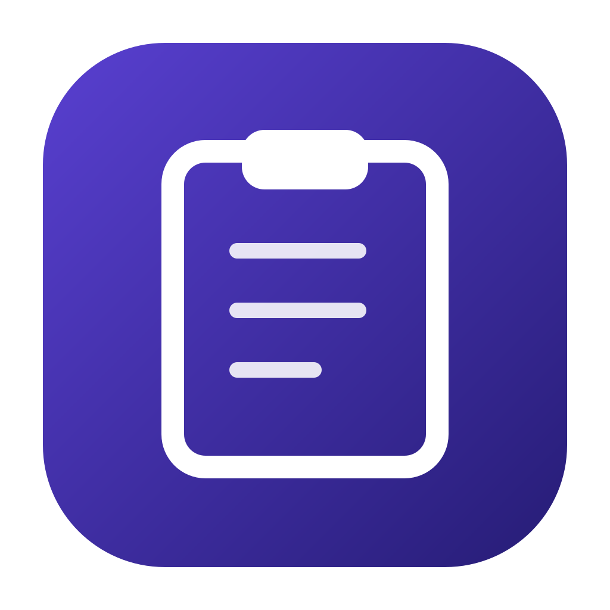

<p align="center"></p>

<h1 align="center">Brightery Clipboard</h1>
<p align="center"><strong>Everything you copy, one shortcut away.</strong></p>
<p align="center">A lightweight, native, local-first clipboard history manager for macOS.</p>
<p align="center">
  <a href="https://github.com/melsaeed/brightery-clipboard-macOs/releases"></a>
  <a href="LICENSE"></a>
  
  
</p>
<p align="center"><a href="https://github.com/melsaeed/brightery-clipboard-macOs/releases">Download releases</a> · <a href="#build-from-source">Build from source</a> · <a href="https://github.com/melsaeed/brightery-clipboard-macOs/issues">Report an issue</a></p>

## Features

- **⌘⇧V** opens a searchable clipboard history from any app.
- Click an entry to paste it into the previously active app.
- Edit multiline text before pasting; choose whether to update the original history or keep it unchanged.
- See copy dates and times, newest first. Re-copying text refreshes its timestamp without duplicating it.
- Menu-bar access, native light/dark appearance, pause recording and clear history.
- Select 10, 20, 50 or 100 items per page.
- Keep history forever, expire after 1, 7, 30 or 90 days, or clear on normal quit.
- Optional launch at login.

## Install

Requires macOS 13 Ventura or later. The build script targets Apple Silicon and Intel in a universal binary.

1. Open [Releases](https://github.com/melsaeed/brightery-clipboard-macOs/releases) and download the DMG when available. Compare its SHA-256 checksum with the published checksum.
2. Open the DMG and drag Brightery Clipboard to Applications.
3. Launch the app, then use its menu-bar icon to request Accessibility permission. Enable it under System Settings → Privacy & Security → Accessibility.
4. Copy some text and press **⌘⇧V**.

Automated builds are ad-hoc signed, not Developer ID signed or notarized. macOS Gatekeeper may block a downloaded build; use Apple's per-app Open Anyway option in Privacy & Security only after verifying the source and checksum. Never disable Gatekeeper globally. Alternatively build locally.

Without Accessibility permission, choosing a clip puts it on the clipboard for manual ⌘V. Some secure fields reject synthetic paste. If the destination cannot regain focus, no paste is injected.

## Build from source

Install Apple's Command Line Tools with `xcode-select --install` if needed.

```sh
git clone https://github.com/melsaeed/brightery-clipboard-macOs.git
cd brightery-clipboard-macOs
./test.sh
./build.sh --install
```

Use `./build.sh` to build without installing, or `./package-dmg.sh` to build a universal DMG and SHA-256 checksum under `dist/`. A valid Developer ID certificate may be supplied using the SIGN_IDENTITY environment variable; notarization is a separate process.

## Lightweight by design

Native Swift, AppKit, Carbon global hotkey API and system SQLite. No Electron, package dependencies, cloud synchronization, analytics or network requests in the app.

| Area | Implementation |
| --- | --- |
| Clipboard polling | 500 ms interval with timer tolerance; checks change count first |
| Storage | SQLite, indexed date order and duplicate detection |
| Cache | 512 KiB SQLite page-cache target (not total app memory) |
| Preview | 240 characters, full text loaded on demand |
| Entry limit | 1 MiB of text |
| Cleanup | Retention pruning and conditional database compaction |

Actual macOS RAM, CPU and disk benchmarks are not yet available. Never-reset history can grow without bound; the poller may miss rapid consecutive copies.

## Privacy

Clipboard text is stored locally at `~/Library/Application Support/Brightery Clipboard/history.sqlite3`. The database has restricted permissions but is **not encrypted by the app**. Images and files are not recorded. Common password-manager identifiers and protected clipboard markers are skipped on a best-effort basis; this is not guaranteed secret detection. Pause recording before copying passwords or other sensitive data. Clear History does not clear the system clipboard, backups or snapshots. The app does not restore previous clipboard contents after pasting.

## Development

```text
Sources/main.swift          AppKit UI, hotkey, monitoring and paste
Sources/HistoryStore.swift  SQLite persistence
Tests/main.swift            Storage regression tests
Icon.swift                  Native icon generator
build.sh                    Universal app build and optional install
package-dmg.sh              DMG and checksum packaging
.github/                    CI and contribution templates
```

See [CONTRIBUTING.md](CONTRIBUTING.md) for testing and contribution guidelines, [SECURITY.md](SECURITY.md) for vulnerability reporting, and [CHANGELOG.md](CHANGELOG.md) for version history.

## License

MIT — copyright © 2026 Brightery. Contributions are welcome.

Built by [Brightery](https://brightery.com).
